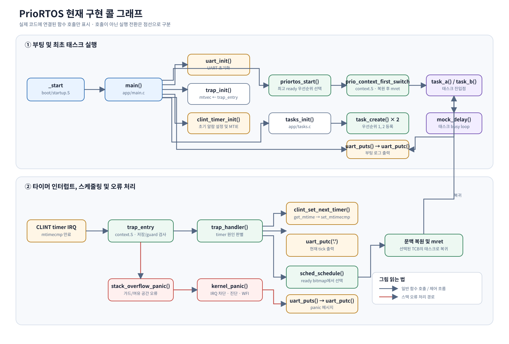

# PrioRTOS 구현 지도

이 문서는 현재 저장소의 파일 구성과 함수 호출 흐름을 기준으로 다음 구현 순서를 판단하기 위한 지도다.
`현재 구현`은 코드가 존재한다는 뜻이며, 테스트나 정형 검증이 끝났다는 뜻은 아니다.
`미구현` 경로는 목표 아키텍처를 설명하기 위해 표시한 것이며 실제 코드 호출 그래프가 아니다.

## 상태 표기

- `[구현]`: 함수 또는 경로가 소스에 있음
- `[부분]`: 골격은 있으나 동작/오류 처리/검증이 부족함
- `[선언만]`: 헤더에 선언됐지만 구현을 찾지 못함
- `[미구현]`: 현재 동작 경로가 없음

## 현재 파일 트리와 함수

```text
PrioRTOS/
├── Makefile
│   ├── all                  -> kernel.elf, kernel.asm 빌드
│   ├── run                  -> QEMU 실행
│   ├── cbmc                 -> verification/cbmc/run_cbmc.sh 실행 시도
│   └── trace                -> verification/traceability 검사 시도
├── boot/
│   └── startup.S
│       └── _start           [구현] 스택 설정 -> BSS 초기화 -> main()
├── app/
│   ├── main.c
│   │   └── main()
│   │       ├── uart_init()
│   │       ├── uart_puts()
│   │       ├── trap_init()
│   │       ├── clint_timer_init()
│   │       ├── tasks_init()
│   │       └── priortos_start()
│   ├── tasks.c
│   │   ├── tasks_init()
│   │   │   └── task_create() x 2
│   │   ├── task_a()         태스크 진입점; uart_putc(), mock_delay()
│   │   ├── task_b()         태스크 진입점; uart_putc(), mock_delay()
│   │   └── mock_delay()     테스트용 busy loop
│   └── tasks.h              tasks_init() 선언
├── bsp/
│   ├── clint.c
│   │   ├── clint_timer_init()
│   │   │   ├── clint_get_mtime()
│   │   │   └── clint_set_mtimecmp()
│   │   ├── clint_set_next_timer()
│   │   │   ├── clint_get_mtime()
│   │   │   └── clint_set_mtimecmp()
│   │   ├── clint_get_mtime()
│   │   └── clint_set_mtimecmp()
│   ├── clint.h               CLINT MMIO 정의 및 타이머 API
│   ├── uart.c
│   │   ├── uart_init()
│   │   ├── uart_putc()
│   │   └── uart_puts()       -> uart_putc()
│   └── uart.h                UART API
├── kernel/
│   ├── include/
│   │   ├── prio_rtos.h       공개 task/semaphore/IPCP mutex API
│   │   ├── kernel_internal.h TCB, 상태, ready bitmap, 내부 선언
│   │   └── stack_guard.h     가드/트랩 프레임 상수
│   ├── sched.c
│   │   ├── task_create()     TCB/초기 문맥/guard 생성, ready bit 설정
│   │   ├── priortos_start()  유효 우선순위 최고 태스크 선택 -> 최초 문맥 전환
│   │   ├── sched_schedule()  엄격히 높은 우선순위 선점, 동순위 현 태스크 유지
│   │   ├── task_yield()      ecall을 통한 공통 재스케줄 요청
│   │   ├── sched_block_current() BLOCKED 전환 후 ecall로 문맥 전환 요청
│   │   ├── sched_wake_task() BLOCKED -> READY 및 ready bit 복구
│   │   ├── stack_overflow_panic() -> kernel_panic()
│   │   └── task_exit_trap()  태스크 함수가 반환할 경우 WFI 루프
│   ├── semaphore.c
│   │   ├── semaphore_init() 초기 카운트/대기 bitmap 설정
│   │   ├── semaphore_wait() 카운트 소비 또는 현재 태스크 block
│   │   └── semaphore_signal() 대기자 wake 또는 카운트 증가
│   ├── trap.c
│   │   ├── trap_init()       mtvec에 trap_entry 등록
│   │   └── trap_handler()    timer interrupt 또는 ecall -> sched_schedule()
│   ├── context.S
│   │   ├── prio_context_first_switch  최초 TCB 문맥 복원 -> mret
│   │   └── trap_entry                 프레임 저장/가드 검사/핸들러/복원
│   ├── ipcp.c                정적 자원 사용자 설정, ceiling, 잠금/대기 및 우선순위 관리
│   ├── panic.c
│   │   └── kernel_panic()    인터럽트 차단 -> UART 진단 -> WFI
├── docs/
│   ├── requirements.md       요구사항 및 상태 기준
│   ├── design-decisions.md   미결정 설계 선택
│   └── implementation-map.md 이 파일
└── linker.ld                 메모리 배치와 시스템 스택 심볼
```

## 현재 코드의 호출 그래프

아래 그림은 실제 코드에 연결된 콜 그래프다. 일반 실선은 함수 호출/제어 흐름, 빨간 선은 스택 오류 처리 경로를 나타낸다. 태스크 진입은 최초 문맥 복원 후 `mret`로 이루어진다.



### 부팅 및 최초 태스크 실행

```text
_start [구현]
└── main [구현]
    ├── uart_init [구현]
    ├── uart_puts [구현]
    │   └── uart_putc [구현]
    ├── trap_init [구현]
    ├── clint_timer_init [구현]
    │   ├── clint_get_mtime [구현]
    │   └── clint_set_mtimecmp [구현]
    ├── tasks_init [구현]
    │   ├── task_create(prio=1) [구현]
    │   └── task_create(prio=2) [구현]
    └── priortos_start [구현]
        ├── ready bitmap에서 최고 우선순위 선택
        └── prio_context_first_switch [context.S]
            └── 선택 태스크 진입점: task_a 또는 task_b
```

### 타이머 인터럽트 및 문맥 전환

```text
하드웨어 timer interrupt 또는 task API의 ecall
└── trap_entry [context.S]
    ├── 스택 여유 공간 검사
    ├── 전체 태스크 문맥 저장
    ├── stack canary 검사
    ├── 현재 TCB의 sp 갱신
    ├── trap_handler [구현]
    │   ├── mcause가 timer interrupt이면
    │   │   ├── clint_set_next_timer [구현]
    │   │   │   ├── clint_get_mtime
    │   │   │   └── clint_set_mtimecmp
    │   │   ├── uart_putc('.')
    │   │   └── sched_schedule [구현]
    │   ├── mcause가 machine ecall이면
    │   │   ├── 현재 trap frame의 mepc를 4 증가
    │   │   └── sched_schedule [구현]
    │   └── 지원하지 않는 원인은 WFI 루프
    ├── 선택된 TCB의 sp로 전환 및 문맥 복원
    └── mret -> 선택 태스크로 복귀
```

### 세마포어를 이용한 A/B 교대

```text
task_a <-> semaphore_wait(sem_a_turn)
       -> A를 TASK_OUTPUT_BURST_SIZE회 연속 출력 -> semaphore_signal(sem_b_turn)
task_b <-> semaphore_wait(sem_b_turn)
       -> B를 TASK_OUTPUT_BURST_SIZE회 연속 출력 -> semaphore_signal(sem_a_turn)

semaphore_wait/signal
└── ready bitmap 및 TCB 상태 갱신
    └── ecall -> trap_entry -> trap_handler -> sched_schedule
        └── 선택 태스크의 문맥 복원 및 실행
```

세마포어는 실행 순서를 동기화하며, IPCP mutex와는 별도 기능이다.

### 오류 경로

```text
trap_entry stack guard/headroom 실패
└── stack_overflow_panic
    └── kernel_panic
        ├── 전역 인터럽트 비활성화
        ├── uart_puts -> uart_putc
        └── WFI 루프

태스크 함수 반환
└── task_exit_trap
    └── WFI 루프
```

## 현재 구현 경계와 미검증 경로

```text
mutex_configure() / mutex_lock() / mutex_unlock() [구현]
└── 정적 user-slot 설정 -> ceiling 계산 -> system ceiling 검사/boost
    -> 차단 대기 -> 적격 대기자에게 unlock handoff
    (자동 IPCP 상태 전이 테스트는 미구현)

semaphore_wait() / semaphore_signal()
└── 현재 A/B 태스크에서 사용; semaphore는 IPCP mutex와 별개

idle task (priority 0)
└── priortos_start()에서 등록; 모든 응용 태스크가 BLOCKED일 때 fallback

CBMC 검증 및 추적성 검사
└── Makefile 타깃은 있으나 verification 하위 파일은 현재 트리에 없음
```

## 다음 구현 순서 제안

기본 READY/BLOCKED 전이와 문맥 전환은 ecall 및 semaphore 경로로 연결했다.
IPCP는 고정 사용자 설정, ceiling 및 유효 우선순위 선택 경로에 연결했다.
다음에는 IPCP 상태 전이의 자동 검증과 idle/빈 ready set 동작을 보완한다.

| 순서 | 다음 작업 | 구현 범위 | 완료 기준 |
|---|---|---|---|
| 1 | idle 동작과 빈 ready set | 슬롯 0 idle 태스크를 등록하고 `sched_schedule()`의 빈 ready set 처리를 정의한다. | 모든 응용 태스크가 BLOCKED여도 커널이 panic하지 않고 idle로 실행된다. |
| 2 | 스케줄러/세마포어 테스트 | 최고 우선순위 선택, semaphore count/handoff, block/wakeup, ecall/timer 통합 테스트를 작성한다. | 두 태스크 교대, 우선순위 대기자 선택, 오류 입력의 반환값과 상태 불변식이 자동 검증된다. |
| 3 | IPCP 테스트 | 정적 설정, system-ceiling 차단, 중첩 lock, boost 복구, handoff 및 동순위 스케줄링을 테스트한다. | 상태·소유권·유효 우선순위·ready bitmap과 API 결과가 기대값과 일치한다. |
| 4 | CBMC 및 시간 측정 | 검증 하네스를 먼저 작성하고, 실제 툴체인/ISA에서 생성 코드와 타이머 주기를 확인한다. 이후 대상 기반 WCET/지연 측정을 수행한다. | 검증 범위와 가정, 측정 환경, 결과가 재현 가능하게 기록된다. |

### 권장 바로 다음 작업

IPCP의 lock/unlock, ceiling 기반 대기자 wakeup, 유효 우선순위 승격/복구와
동순위 비선점 규칙을 먼저 자동 테스트한다. 이어서 scheduler/semaphore 상태 전이와
모든 응용 태스크가 BLOCKED가 된 경우 idle fallback을 검증한다.

## 확인 시 주의할 점

- `g_ready_bitmap`의 C 타입은 32비트이며 비트는 태스크 슬롯을 나타낸다. 현재 선택은 `MAX_TASKS` 순회 방식이며 실행시간 상한은 타깃에서 측정해야 한다.
- `g_ready_bitmap`은 슬롯을 나타낸다. block 시 해당 슬롯 비트를 제거하고 wake 시 복구하며, RUNNING 태스크도 bitmap에 포함한다.
- `TIMER_INTERVAL`은 10 MHz 기준 10,000,000 tick으로 설정돼 있어 1초에 해당한다. 1 ms tick으로 사용하려는 의도라면 timebase와 함께 재결정해야 한다.
- 트랩의 system stack과 `mscratch` 접근 경로가 코드에 있지만, 반복 선점·가드 손상·레지스터 보존 테스트를 통과하기 전에는 보호 기능 검증 완료로 보지 않는다.
- Makefile 타깃 이름이 존재하는 것만으로 CBMC/trace 실행 파일이나 검증 결과가 존재한다고 판단하지 않는다.
